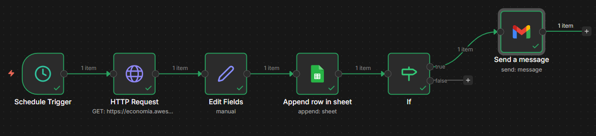
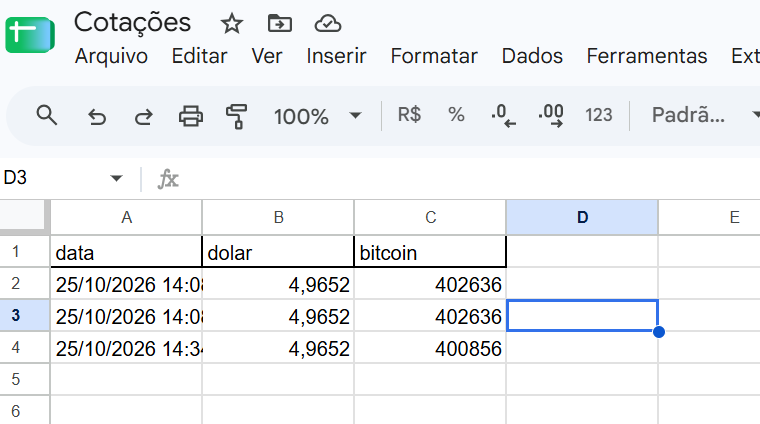
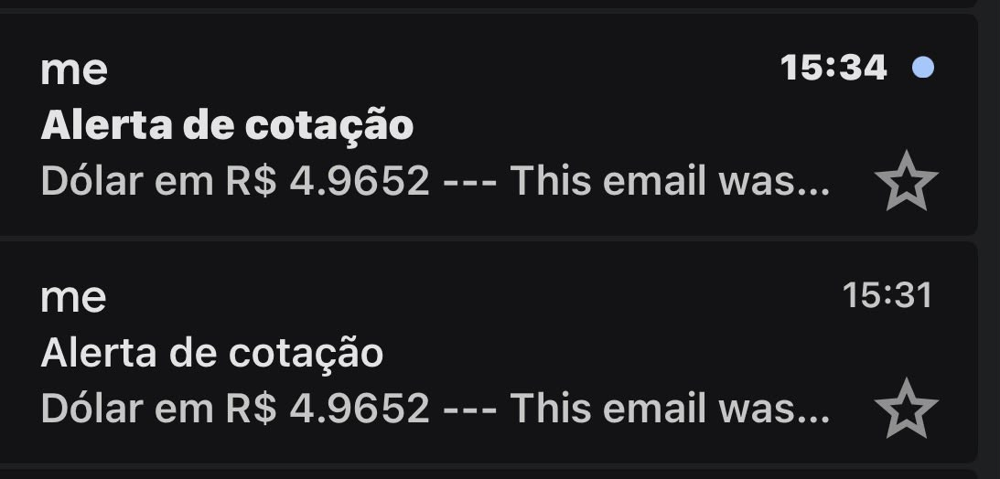

# Monitor de Cotações com n8n

Automação em n8n que coleta as cotações de dólar e bitcoin a cada hora, grava o histórico no Google Sheets e envia alerta por e-mail quando o dólar passa de um valor definido.

## Como funciona

1. **Schedule Trigger:** dispara o fluxo a cada hora
2. **HTTP Request:** consulta a AwesomeAPI (USD-BRL e BTC-BRL)
3. **Edit Fields:** seleciona data, dólar e bitcoin
4. **Google Sheets:** registra cada leitura em uma planilha (histórico)
5. **IF:** verifica se o dólar passou do limite
6. **Gmail:** envia o alerta por e-mail

## Tecnologias

- n8n
- AwesomeAPI (cotações)
- Google Sheets API
- Gmail API
- OAuth2 (Google Cloud)

## Imagens

### Fluxo no n8n

### Histórico na planilha

### Alerta por e-mail

## Como rodar

1. Instale o n8n (`npm install n8n -g`) e inicie com `n8n start`
2. Importe o `workflow.json` (menu ⋯ → *Import from file*)
3. Crie as credenciais do Google Sheets e do Gmail (OAuth2 pelo Google Cloud)
4. Crie uma planilha com os cabeçalhos `data`, `dolar` e `bitcoin`
5. Selecione sua planilha no nó Google Sheets e ative o workflow

## Aprendizados

- Consumo de APIs REST
- Automação de fluxos e agendamento
- Autenticação OAuth2 com Google Cloud
- Registro de dados em planilha como base para dashboards (Power BI)

## Próximos passos

- Conectar a planilha ao Power BI para visualizar a evolução das cotações
